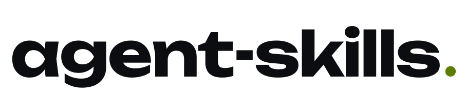

<p align="center">
  <picture>
    <source media="(prefers-color-scheme: dark)" srcset="assets/wordmark-dark.svg">
    
  </picture>
</p>

<p align="center">
  <b>Skills and hooks for coding agents, in one marketplace.</b><br>
  Install them into Claude Code with two commands; each one points at a self-hosted service you control.
</p>

<p align="center">
  <a href="https://github.com/ly-solutions/agent-skills/actions/workflows/ci.yml"></a>
  <a href="LICENSE"></a>
</p>

---

## Install

```text
/plugin marketplace add ly-solutions/agent-skills
/plugin install harnessly@ly-solutions
/plugin install boards@ly-solutions
/plugin install artifacts@ly-solutions
/plugin install agent-guard@ly-solutions
```

## What is inside

| Plugin | What the agent gets | Needs |
| --- | --- | --- |
| [**harnessly**](plugins/harnessly) | Shows documents, boards, files and dev servers to the person in the right pane of the conversation, lists the workspace's tabs, starts and reads another agent (Claude Code or Codex) in a new tab. | A [harnessly](https://github.com/ly-solutions/harnessly) workspace: the `harnessly` command, found by itself in every tab |
| [**boards**](plugins/boards) | Reads a whiteboard as text from its link, draws a diagram from a node/edge graph (the server lays it out), edits shapes, replies to comments. | A [boards](https://github.com/ly-solutions/boards) server: `BOARDS_URL`, `BOARDS_TOKEN` |
| [**artifacts**](https://github.com/ly-solutions/artifacts/tree/main/skills/artifacts) | Finds documents before writing a new one, publishes new versions of the same page, shares only when asked. | An [artifacts](https://github.com/ly-solutions/artifacts) catalog: `ARTIFACTS_URL`, `ARTIFACTS_TOKEN` |
| [**agent-guard**](https://github.com/ly-solutions/agent-guard) | Hooks that refuse destructive commands (`pkill -f`, force pushes, tokens in files…) and hand back the safe one. | Python 3.10+, nothing else |

`harnessly` and `boards` live in this repository; `artifacts` and `agent-guard` are installed from their own
repositories, so they are always the version their projects release.

## Use them with harnessly

[harnessly](https://github.com/ly-solutions/harnessly) runs Claude Code and Codex on your machines, and it installs
these skills for both of them by itself: `harnessly` always, `boards` and `artifacts` when their servers are
configured (`RUNTIME_BOARDS_URL`, `RUNTIME_ARTIFACTS_URL`). Nothing to do by hand. It also puts the `BOARDS_*` and
`ARTIFACTS_*` variables into every conversation it starts, so the skills work in each of them at once. The marketplace
above is for Claude Code outside harnessly.

## Contributing

Skills are plain `SKILL.md` files with their scripts. Keep them neutral: no hosts or names of a particular deployment,
configuration through environment variables. CI validates the marketplace and every plugin manifest.

## License

[Apache-2.0](LICENSE)
